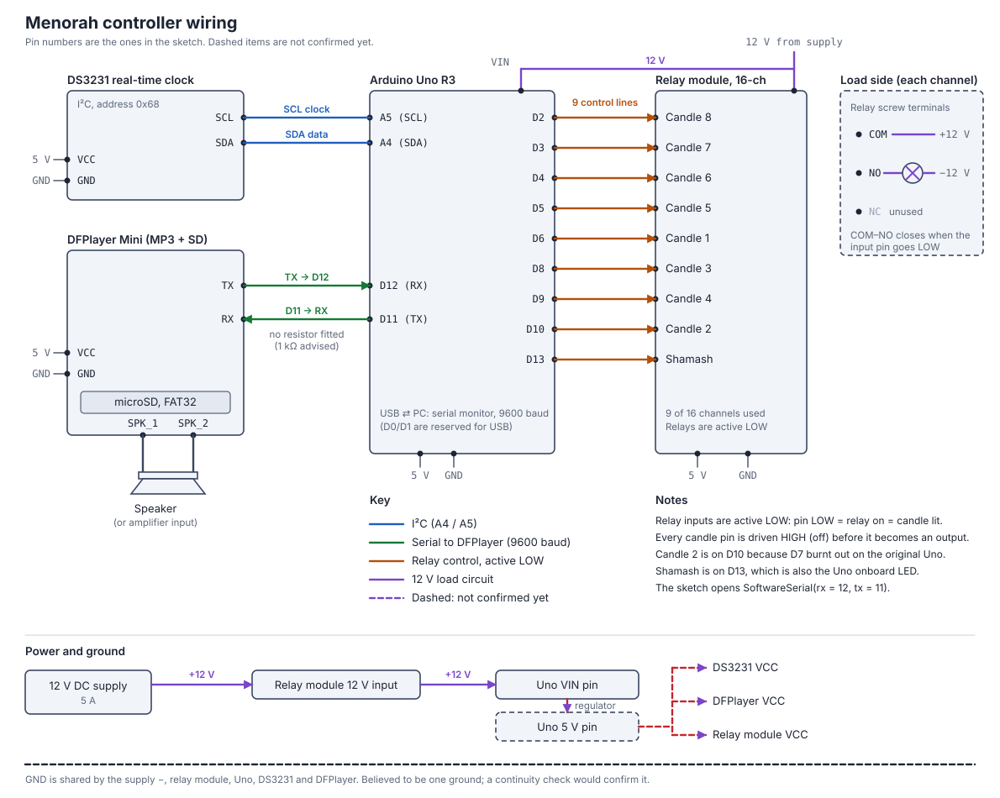

# Temple Shir Tikva Menorah Controller

An Arduino sketch that runs an automated menorah. It keeps its own time with a real-time clock, works out which night of Hanukkah it is, plays the three blessings from an MP3 module, and switches a relay board to light the candles in order. The Hanukkah dates are built in for 2025 through 2043. **The table must be extended before Hanukkah 2044** (see [Extending the Hanukkah table past 2043](#extending-the-hanukkah-table-past-2043)).



## What it does

The unit is typically powered up at sunset and cut at sunrise. From the moment it starts, and then once a second, it reads the clock and decides what to show:

| Situation | Candles | Prayers |
| --- | --- | --- |
| A Hanukkah night, between 10:00 and 20:00 | Shamash plus one candle per night | Said once, then lit |
| A Hanukkah night, 20:00 or later | Same, so a late reboot restores the display | Not said |
| After midnight, before 10:00 | Still last evening's night | Not said |
| Not Hanukkah | All 8 candles and the shamash | Not said |

- **Prayers come before the candles.** Prayer 1 is the blessing for lighting, prayer 2 is the blessing for the miracles, and prayer 3 (Shehecheyanu) is only said on the first night. The candles light after the prayers finish.
- **Prayers are not repeated.** The date the prayers were last said is kept in EEPROM, so a power blip during the evening relights the candles silently. This writes 3 bytes about once per night (only bytes that change are written), far below the EEPROM's rating of roughly 100,000 writes.
- **The candle display always recovers.** If the shamash is ever found unlit, or the night changes, the menorah relights itself.
- **A missing or slow MP3 board never stops the candles.** See [MP3 board startup](#mp3-board-startup).

The night belongs to the date it was lit. Between midnight and 10:00 the controller looks up *yesterday's* date, which is why a unit that is still running after midnight shows the right number of candles.

## Hardware

See the diagram above for the wiring. The parts are listed [at the bottom](#parts-list).

### Pin assignments

| Function | Uno pin | Notes |
| --- | --- | --- |
| Candle 1 | D6 | |
| Candle 2 | D10 | D7 burnt out on the original Uno |
| Candle 3 | D8 | |
| Candle 4 | D9 | |
| Candle 5 | D5 | |
| Candle 6 | D4 | |
| Candle 7 | D3 | |
| Candle 8 | D2 | |
| Shamash | D13 | Also the Uno's onboard LED |
| DFPlayer TX to Uno | D12 | `SoftwareSerial` receive pin |
| Uno to DFPlayer RX | D11 | `SoftwareSerial` transmit pin. No series resistor is fitted; it works, but a 1 kΩ resistor is advised because the Uno drives 5 V into the DFPlayer's 3.3 V input |
| RTC SDA / SCL | A4 / A5 | I²C, address 0x68 |

The relay board is **active LOW**: driving a pin LOW closes the relay and lights the candle. At startup every candle pin is driven HIGH *before* it is made an output, so the relays don't glitch.

The soft serial port is declared `SoftwareSerial(12, 11)`, which is `(rx, tx)`. The numbers match the working wiring; don't change them.

### Power

The 12 V supply feeds the relay module, and the Uno takes its VIN from the relay module's 12 V. The Uno's 5 V pin powers the RTC and DFPlayer. All boards share one ground.

### Not confirmed yet

The code can't see the power wiring, so a few details in the diagram are dashed as unconfirmed: that the relay board's logic side is powered from the Uno's 5 V pin, that every board returns to the same ground (a continuity check would settle it), and that each lamp is wired to its relay's COM and NO terminals.

## Software setup

1. Install the Arduino IDE and select **Arduino Uno**.
2. Install the **DFRobotDFPlayerMini** library (Library Manager). `SoftwareSerial`, `Wire` and `EEPROM` ship with the IDE.
3. Open `menorah_controller.ino` and upload.

With the Arduino CLI: `arduino-cli compile -b arduino:avr:uno .`

## Sound files

Use an SD card of 32 GB or less, formatted FAT16 or FAT32. Create a folder named `mp3` in the root and copy the files from `prayer_sound_files/mp3/` into it. The files must be named with four digits:

| File | Prayer | Played |
| --- | --- | --- |
| `0001.mp3` | Blessing for lighting the Hanukkah candles | Every night |
| `0002.mp3` | Blessing for the miracles | Every night |
| `0003.mp3` | Shehecheyanu | First night only |

The recordings came from these videos: [1st blessing](https://www.youtube.com/watch?v=_fb-tkAet5A), [2nd blessing](https://www.youtube.com/watch?v=6n3aQlSSkCM), [3rd blessing](https://www.youtube.com/watch?v=LEO0z5jfYtw).

## MP3 board startup

The DFPlayer needs one to three seconds after power-up to mount its SD card, so the sketch never blocks waiting for it. `setup()` starts it booting, and a small state machine finishes the job in the background while the candle logic runs:

1. **Listen.** For 1.5 s the sketch waits for the board's own "card online" message.
2. **Reset.** If it stays quiet, the sketch sends a reset and waits up to 3 s for "online".
3. **Settle.** Volume, EQ and the SD output are set. The board is now ready.
4. **Retry.** If there's no response, it tries again, up to 5 attempts, then pauses 30 s and starts another round. This repeats for as long as the unit is powered.

Before saying prayers, `lightCandles()` waits at most 10 s for the board. If it isn't ready by then, the candles light without audio. A board that comes up late is used from the next lighting.

The sketch deliberately does **not** check the SD card's file count, because the DFPlayer doesn't report it reliably. A missing file shows up when it is played: the serial log shows an error and playback moves on.

Each prayer is played until the board reports it finished (with a 40 s safety cap).

### Troubleshooting

| Serial output | Meaning |
| --- | --- |
| `mp3 initialized` | Board is ready |
| `mp3 init attempt N failed: no response from board` | Check that DFPlayer TX goes to D12 and D11 goes to DFPlayer RX, that it has 5 V, and that the SD card is inserted |
| `mp3 board unavailable; will keep retrying in the background.` | Five attempts failed; it will try again in 30 s |
| `mp3 board not ready; lighting without audio prayers.` | The 10 s wait ran out; candles lit anyway |
| `mp3 board reported an error during playback.` | Usually a missing or misnamed file on the SD card |
| `Gave up waiting for the prayer to finish.` | No "finished" message in 40 s; playback continued anyway |
| `Prayers were already said tonight; not repeating them.` | Normal after a mid-evening reboot |

## Diagnostic menu

The menorah runs normally from power-up. **Send any character over the serial monitor (9600 baud) to open the menu.** Normal operation pauses while it is open and resumes when you choose `0` or after 60 seconds of no input. If the menorah is in the middle of lighting, for example while a prayer is playing, the menu opens when that finishes.

Any line-ending setting in the serial monitor works.

| Command | What it does |
| --- | --- |
| `0` | Exit and resume normal operation |
| `1` | Set the clock (year, month, date, day of week, hour, minute, second) |
| `2` | Display the time |
| `3` | Play prayer 1 |
| `4` | Test a Hanukkah night (1 to 8), with or without prayers. Send any character afterwards and the real state is restored |
| `5` | Print the current state of the menorah |
| `6` | Print MP3 board diagnostics |
| `7` | Light each candle in turn, one second apiece, then restore the real state |

### Setting the clock

Use command `1`. The DS3231 has no daylight-saving logic, so set it to the local time that is in effect on Hanukkah and it will stay right. The quiet-hours cutoffs (20:00 and 10:00) are wide enough that a few minutes of drift doesn't matter.

## Maintaining the code

### Source files

| File | Responsibility |
| --- | --- |
| `menorah_controller.ino` | Setup, the main loop, candle relays, prayer logic, diagnostic menu |
| `sound_controller.cpp/.h` | DFPlayer startup state machine, playback, diagnostics |
| `clock_controller.cpp/.h` | DS3231 access, time formatting, date arithmetic |
| `hanukkah_day.cpp/.h` | The table of Hanukkah nights and the date lookup |
| `user_input.cpp/.h` | Reading numbers and keystrokes from the serial monitor |
| `menorah_strings.h` | Shared text (kept in flash) and the shared `SERIAL_WAIT_TIME` |
| `Menorah.h` | Includes the project headers for the sketch |

### Settings you might change

| Constant | File | Default | Meaning |
| --- | --- | --- | --- |
| `QUIET_HOURS_START_HOUR` | `menorah_controller.ino` | 20 | From this hour, a reboot won't say new prayers |
| `QUIET_HOURS_END_HOUR` | `menorah_controller.ino` | 10 | Before this hour it is still last evening's menorah |
| `MP3_PRAYER_WAIT_MS` | `menorah_controller.ino` | 10000 | Longest wait for the MP3 board before lighting without audio |
| `CLOCK_CHECK_INTERVAL_MS` | `menorah_controller.ino` | 1000 | How often the clock is read |
| `MENU_IDLE_TIMEOUT_MS` | `menorah_controller.ino` | 60000 | Menu inactivity timeout |
| `MP3_BOOT_DELAY_MS`, `MP3_ONLINE_TIMEOUT_MS`, `MP3_MAX_ATTEMPTS`, `MP3_RETRY_PAUSE_MS` | `sound_controller.cpp` | 1500, 3000, 5, 30000 | MP3 startup timing |
| `MP3_MAX_PRAYER_MS` | `sound_controller.cpp` | 40000 | Safety cap on one prayer |

### Extending the Hanukkah table past 2043

> **Deadline: the table ends with Hanukkah 2043.** After that the clock matches no row, so the menorah treats every day as not Hanukkah: it lights all eight candles and says no prayers. Add the new rows before then. Each added year is 8 rows, about 32 bytes of flash.

The table in `hanukkah_day.cpp` stores the *evening* each candle is lit. Each row is `{yearOffset, monthOffset, day, night}`, where `yearOffset` is the year minus 2024 and `monthOffset` is 0 for November, 1 for December and 2 for January (a January row uses January's own year).

`tools/verify_hanukkah_table.py` recomputes every night from the Hebrew calendar and compares it with the table. Run it with no arguments to check the existing rows, or give it a later last year to get rows to paste in:

```
python3 tools/verify_hanukkah_table.py 2025 2050
```

Python 3 is the only requirement. Paste the printed rows at the end of `hanukkahDays[]` in `hanukkah_day.cpp`, update the years in that file's header comment and in the README intro, then rebuild and upload. The DS3231 library's two-digit year limits the clock to 2099 regardless.

## Parts List
* DFPlayer Audio Music Module for Arduino https://www.amazon.com/dp/B08FFLH5XL?ref=ppx_yo2ov_dt_b_fed_asin_title&th=1
* HiLetgo 5pcs DS3231 High Precision RTC Real Time Clock Module https://www.amazon.com/dp/B01N1LZSK3?psc=1&smid=A30QSGOJR8LMXA&ref_=chk_typ_imgToDp
* Arduino Uno https://www.amazon.com/Arduino-A000066-ARDUINO-UNO-R3/dp/B008GRTSV6?crid=P0FCQ22V3FZT&dib=eyJ2IjoiMSJ9.MazmhFfn-DF8W5oyX_S-tDFAqLRDaMJSkroaZhdQMdgGxJujWYy51xVRihYRF1ezRrtJ-qByH-U1X8qhZiyjdX93sX8KDwJX4Vv0L7iEq8K9WuU9q8dO5m5DPJkUSHe07yBbz5Rz-isUq88MNhsr4XVCxpwwcu4XyjQXw4ktsxGVKCMboqtVG-p9TlsvXIoEhqV67LNCO3PjX2sEgkN85nuvrQS1DNPaOf40qkhsoSmJat3iE7BYru8jdhtEjKpavbVESGvKxYLBLwS2jZr5iFX2HYLeTueK03srczb9tCmdbL6TG_6V_0b0KgygJDc2-FQ_zEE0fjzscyuo-dqF1Py2GKinREPu7lf3AhaK6Wc.OxZLVwwsgU3AA9Y6fsc8F62m4oTB1HacpDt_Ea00zSA&dib_tag=se&keywords=arduino+uno&qid=1734288439&s=industrial&sprefix=arduino+uno%2Cindustrial%2C125&sr=1-3
* PNY 32gb SD Card https://www.amazon.com/dp/B07R8GVGN9?ref=ppx_yo2ov_dt_b_fed_asin_title
* Jumper Wires https://www.amazon.com/dp/B07GD2BWPY?ref=ppx_yo2ov_dt_b_fed_asin_title
* Waterproof project box https://www.amazon.com/dp/B0CQG2KM5X?ref=ppx_yo2ov_dt_b_fed_asin_title&th=1
* 12vdc 5a power supply https://www.amazon.com/dp/B07GFFG1BQ?ref=ppx_yo2ov_dt_b_fed_asin_title&th=1
* Sainsmart 16 channel 12v relay module https://www.amazon.com/dp/B0057OC66U?ref=ppx_yo2ov_dt_b_fed_asin_title&th=1
